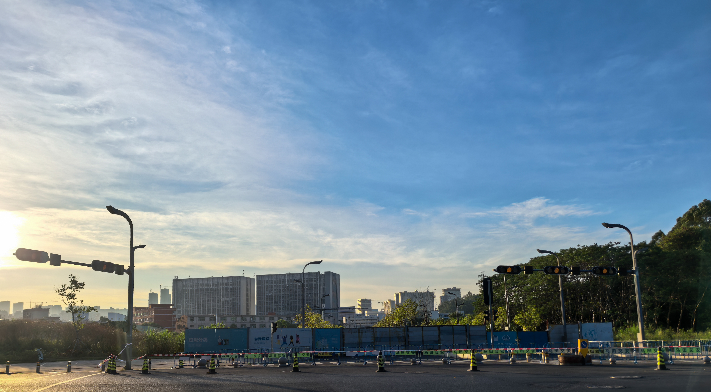
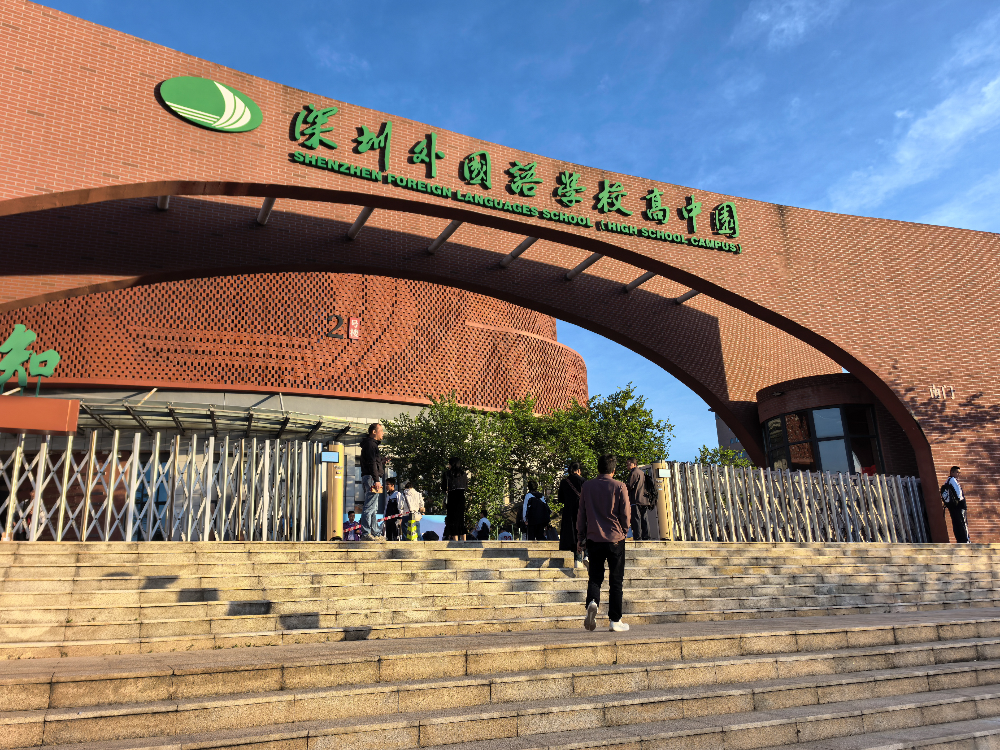
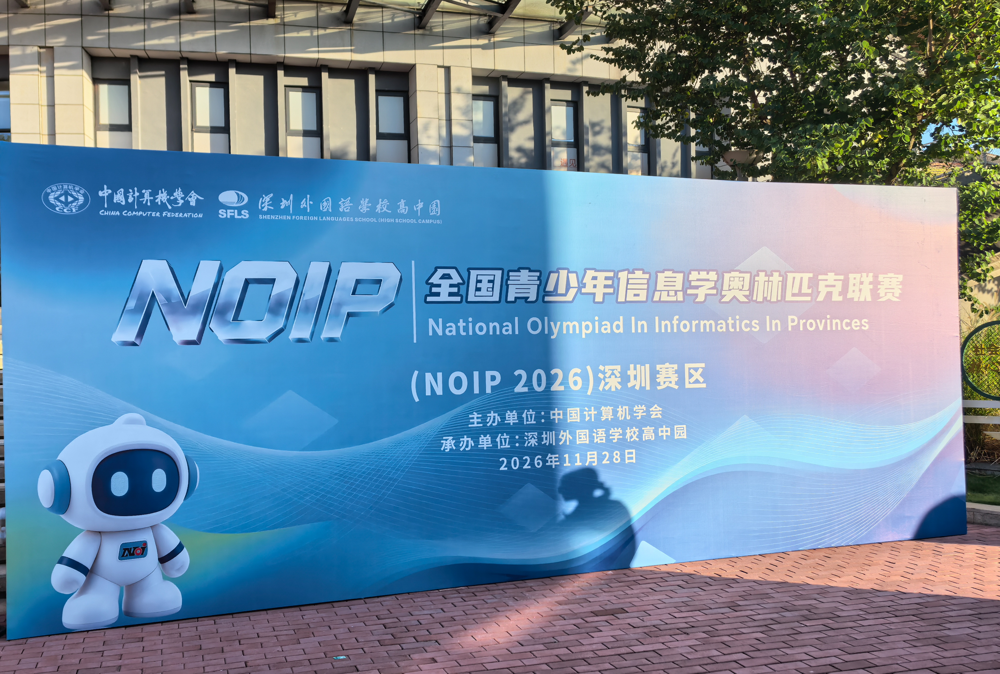
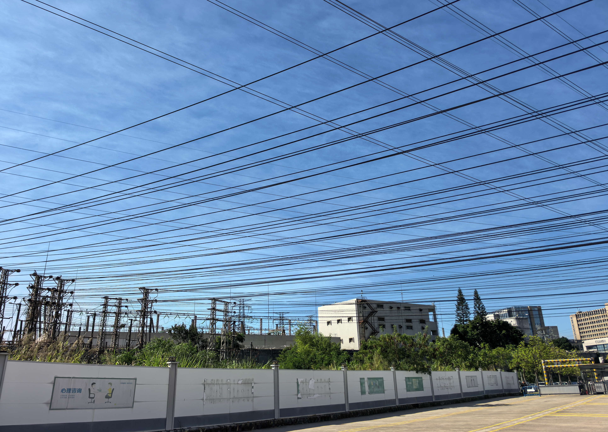
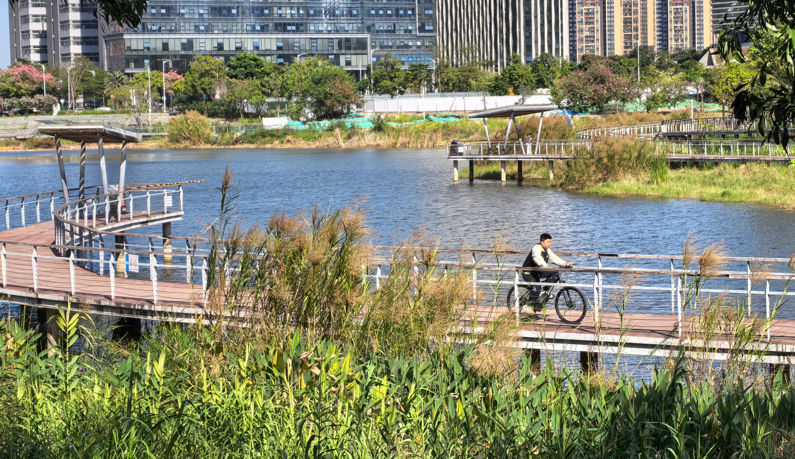

---
category:
- blog
date: 2026-11-28
isOriginal: true
tags: []
title: 2026 NOIP游记 —— What do you want more than a Happy ending？
---

## 0. 前言

在[CSP-S](./CSP J／S 2026 复赛 —— 故地重游.md)考完之后，信竞打得就更少了，只在一个周日下午打过模拟赛，以及考试前一天去机房练了一节课的题，其他时间几乎没怎么看信竞。

而就在考前的周五，还和同学出去吃饭，晚上回到家只复习了最短路、线段树、快速幂等几个模板，便上床休息了。但在床上也不好过。平时我不管在什么时候喝咖啡，基本都不会影响晚上的睡眠质量，但这天从十一点上床就一直在辗转反侧，直到 1 点左右才睡着。而早上六点，又要起床，准备动身了。

十一月底，太阳马上要直射南回归线，六点的天色仍不可见。急急忙忙坐上车，把手中的豆浆喝完，再听一首《不要对他说再见》[^1]，迷迷糊糊地睡着了。

---

再醒来，天色已然大亮，天气极好，天上只有几丝薄云。似乎自从去年起，每次复赛和 NOIP 都是这样的好天气。前几天深圳晚上还下雨呢。风并不小，尚有寒意，但有阳光照着，尚且是舒服的。
在熟悉的十字路口下车，走到学校南门。是的，第三次回到了这里——深外高中园。

在门口等到同学，顺手拍了一张 NOIP 背景板（是这样叫的吗？）的空景。等上一个在这里拍照的同学走后，一群人都异口同声地说让下一位同学稍等一下，让他们拍一张没有人的空镜照片。似乎有这个想法的人并不在少数。

但突然发现，早晨慌乱中忘记带矿泉水了，水杯也是不透明的，这下考试可没水喝了。一般人也没有带好几瓶矿泉水的习惯，倒是有一位同学给我投喂了一个小面包，在此感谢他~
八点钟，进考场。八点二十七，开考。

## 1. 在考场上

这次 CCF 又整了点新东西出来，给解压专门搞了个 `请用此工具解压试题包.exe`，点一下就自动解压完成了。密码是 `big#Surprise@26` 。这次 `checker.exe` 也把配置写好了，不用自己生成题目列表，好事。

把各个文件夹配好，开始看题。

### T1

> [!note] 题目大意
> 给定两个数 $a, b$，求一个非负整数 $x$ ，求 $a+x, b+x$ 的最小公倍数的最小值
> [洛谷原题](https://www.luogu.com.cn/problem/P18115)

看到这个题，突然发现自己已经忘记最小公倍数怎么求了，只记得最大公约数的辗转相除怎么求。好在还有 Excel 用，直接拉一列 `LCM(A2,B2)` 和一列 `GCD(A2,B2)` ，然后找规律，发现 $lcm(a,b) = a \times b \div gcd(a,b)$ ，这下算法这一关总算是过了，接下来就是思路的问题。把各种数据拉在 Excel 表上，先尝试了一下最暴力的解法：一个一个枚举 $x$。但不知道 $x$ 的枚举上界是多少，索性不设上界，让 $lcm(a,b)_{min} > a+x$ 的时候就跳出，然后喜提一个越界。后面猜了一个结论，如果 $a+x > b  (a < b)$ 的话，以后可能再怎么枚举 $x$ 都不会得到更优结果了，索性就让 $x$ 从 $0$ 枚举到 $\Delta = |a-b|$，至少在样例上没什么问题。接着回去继续观察 Excel 里面的数据，发现如果在二者相差 $1$ 的时候，不管加多少都是负优化，那直接输出二者之积即可，正好这就是特殊性质 A 。特殊性质 B 是 $|a-b| <= 10^4$ ，给刚刚的暴力算法用。
特殊性质 C，$\Delta$ 一定为质数，一开始没想到有什么用。后面在 Excel 发现部分数在 $\Delta > a$ 的时候，让 $x = \Delta - min(a,b)$，在 $a<b$ 且 $\Delta > a$ 时，$a+x=\Delta， b+x = (\Delta-a) + b$ ，此时求出来的值就是最小值。但是对于某些样例来说，求出来的值会偏大。但是似乎只要 $\Delta$ 为质数，答案都是正确的，正好对应特殊性质 C ，那就把特殊测试点用这段特殊逻辑来处理。剩下的交给暴力。如果在最最理想的情况，19、20 两个测试点拿不到，其他的应该能骗足够的部分分。

> 赛后听了一下正解，似乎只要在这条路上更进一步，枚举 $\Delta$ 的所有因数即可……
> 临门一脚啊……

### T2
> [洛谷原题](https://www.luogu.com.cn/problem/P18116)

一开始 T1 写到一半没思路，索性先来看 T2。题意还算简单，从一个位置开始走，如果攻击力够的话就击败魔兽，提升攻击力，继续走，不行的话就转向。这道题模拟比较好写，正解的话似乎需要一个可以维护区间的结构，暂时没什么想法，所以先从暴力开始。
看看数据范围，每次查询请求最多 $10^{15}$ 步，如果真的一个一个走的话肯定是走不完的，那不如从魔兽来枚举，每次尝试走到下一个魔兽，并且判断能不能打败，以及是否要转向。魔兽之间通过链表来维护关系，这样每次走一步就都是 $O(1)$ 的了。看起来每次查询的复杂度是 $O(n)$，对于一个暴力来说已经足够了。但是这道题有个问题，如果你的攻击力一直不够的话，就会在两个怪物之间循环，每次只用掉一点点步数，那和暴力枚举也没什么区别了。所以又引入一个 `last_access_attack` 变量，如果再走过来的时候攻击力还是一样的，那么这次走过来并不会产生任何新的结果，攻击力以后也不会发生改变了，直接退出即可。状态是否发生改变也是个惯用伎俩了，每次想不出来循环终止条件就用状态来判定，如果状态不会再发生改变那就将要发生死循环，也就没必要继续循环了。
在十二点半考试马上要结束，准备检查 `freopen` 的时候，跑了几个样例，发现答案对不上，赶忙回去 debug，最后用了五分钟，发现最后判断是否还有下一个魔兽的条件写错了，原本应该判断的是魔兽的下标是否为 0 ( 0 作为链表哨兵)，但实际上写成了坐标是否为 0。这道题的坐标正数负数都有可能，所以在一些情况就出问题了。
按照数据范围来看，应该能跑 5-6 个点的样子，不知道能混多少分。

### T3 & T4
> [T3](https://www.luogu.com.cn/problem/P18117) 
> [T4](https://www.luogu.com.cn/problem/P18118)

T3，看题面要求组合状态数，看起来就是 DP 了。但是比较棘手的是它要算出来每一种状态的和，接着跑快速幂。普通的 DP 我都干不出来，这个更搞不出来了。倒腾半天 DFS，也没倒腾出来，最后索性送一个 `rand()` 给快速幂，让它自己求去吧。如果真的能过一个点那运气好的就有点离谱了。

T4，~~题都没有看~~，写个输入输出，按题目要求的输出量全部输出 0 得了。

---

在昨天晚上休息得这么差的情况下能连着 4.5 个小时一直在搓题，甚至最后临结束的 debug 还成功了，已经比上次有很大进步了，足矣。

~~但是为什么这次每道题都是多组输入输出，骗分难度爆炸~~

> [!note] 一些趣事
> - 上了很多很多次厕所，我自己都记不清多少次了
> - 到最后一口水没喝
> - 一开始建文件夹依旧磨蹭了半小时
> - 已经可以熟练地把 Dev C++ 的格式化补全改成 `Ctrl + Alt + L` 了
> - Sublime Text 很好用

## 2. 考试之后

回到校门口，艳阳高照，万里无云，穿着外套都可以说有点炎热了，索性只留一件短袖。和考[CSP-S](./CSP J／S 2026 复赛 —— 故地重游.md)的时候不同，今天门口的人格外多，连我们老师都决定不拍集体照了。最后索性和同学在人群前自拍一张，露出蓝色的背景板，足矣。

---

出校门后，选择了和上次不同，但是和[2025年](./CSP J／S 2025-复赛.md)一样的路，右转，去公明广场地铁站那边。这次不像上次那么走运，能找到一辆共享单车骑，只能和同学走路，看着道路渐渐熟悉，经过拦着不让车过，空旷的道路，看电线层层叠叠的变电站，路过工业区，然后逐渐进入居民区，看周围的车和人渐渐多起来，最后，来到熟悉的地铁站旁。

至于为什么要过来？本来是想要买一杯 Manner 咖啡的，但是到地方才发现店已经锁上了，什么都买不到。最后只能和同学享用一顿麦当劳，随后，再一进站就看到六号线，以及上个厕所要费半天劲，绕一大圈到对面站台，再要绕回来这一侧站台坐车，似乎，已经是轻车熟路了。

只是可惜，这次来吃饭的只有一位同学，不再像[CSP-S](./CSP J／S 2026 复赛 —— 故地重游.md)那时候一大群人热热闹闹的了。

到此，我的信竞生涯结束了。

---

> 按理来说，在这里应该写一点退役感言。但我想要单独再写一篇文章。
> 所以，让这段故事的余韵再长一些吧。

[^1]: 来自深海呼吸乐队