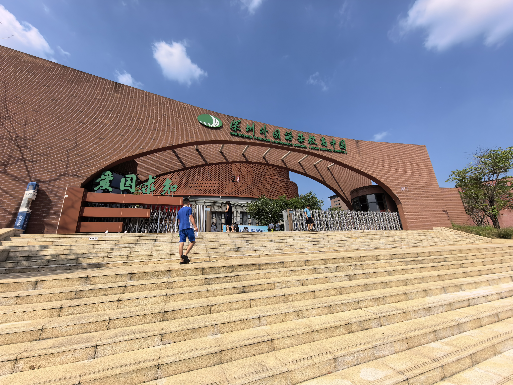
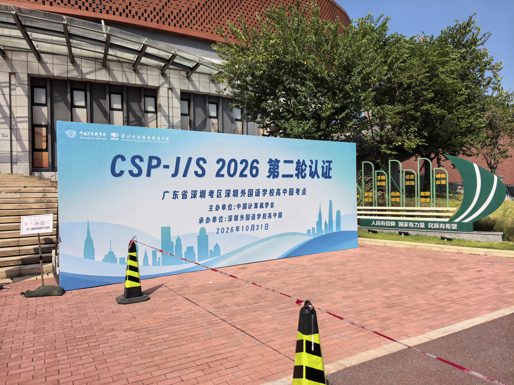
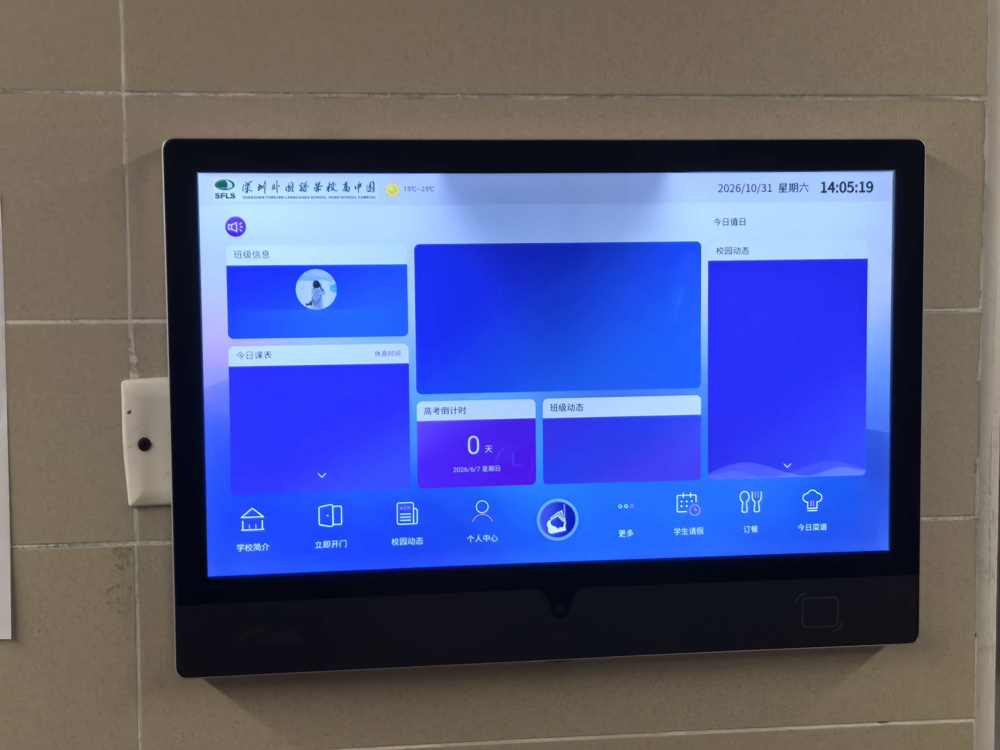
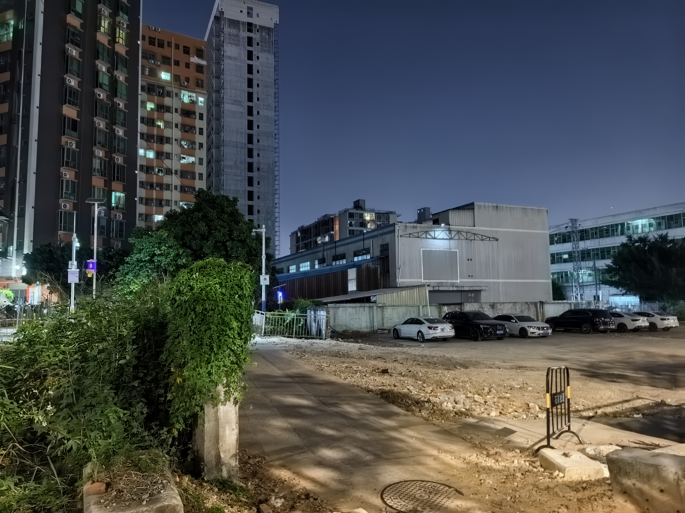
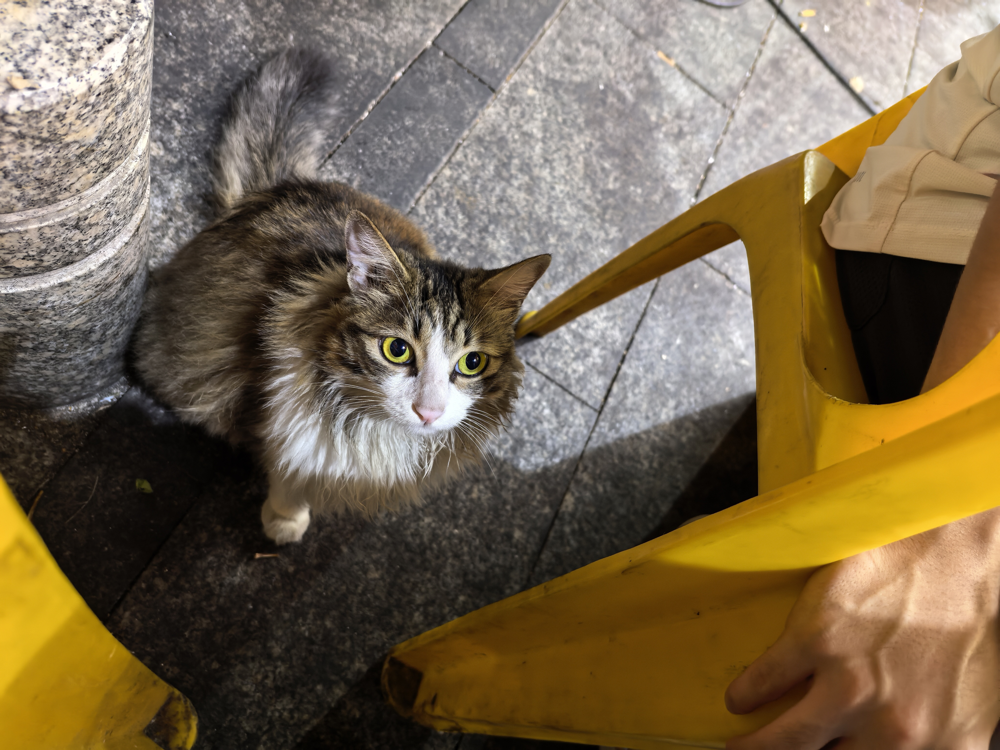

---
category:
- blog
date: 2026-11-01
isOriginal: true
tags:
- 游记
title: CSP J／S 2026 复赛 —— 故地重游
---
本篇游记本应在11月1号就发出来，但是排版、纠错、配图等事情实在是用了太久……
## 0. 前言
初赛刚过，一转眼，复赛又来了。

国庆后的事情一茬接一茬，早就被提上日程的复习一拖再拖，只剩下每周三个小时在学校学信竞。雪上加霜，这次CSP-S刚好就在学校期中考试之后。刚结束筋疲力竭的6科考试，又要赶回家复习CSP-S。

当然，不出所料，那天晚上就复习了个 `freopen` 的板子，剩下的时间全都在摸鱼。等到周六早上，剩下的时间也只能复习一些代码的板子：最短路、LCA、快速幂、前缀和与差分。~~简直可以说这次是裸考~~

这次考试的地点和去年一样，是深外高中园，在光明。去光明的路程很漫长，路上总该找点歌听，但不知道听什么，百无聊赖地翻着Apple Music。不知出于什么理由，最后选了《海阔天空》《光辉岁月》等几首粤语歌。
窗外的高楼渐渐少了，再一抬头，只剩下大片的平地，和远处的居民楼了。

## 1. 欢迎回到光明

一切似乎都和去年一样。天气仍是明媚的，炽热的阳光将校门口的阶梯染得澄黄，路上只有零星几辆车经过。距离开始还有一段时间，去到旁边的大礼堂，上二楼，先找同学闲谈一二，顺便看看一直在播放的宣传片。


> 大礼堂二楼厕所的水龙头有些神奇，喷出来的水并不是很多，而且是四散的，并不是水流。想到之前小时候看到一个营销号，说外国有人设计了一个水龙头，只喷到手上一点水用来溶解脏东西，剩下的用空气冲走，以此节水。兴许这个水龙头也是类似的节水设施？
> 但是在考场那的厕所却又是正常的了。

约莫两点，顺着右边的小路前往考场。这次没有遇到像[上次](./CSP J／S 2025-复赛.md)一样迟迟进不去的问题。但是在机房门口又看到了和我们学校一模一样的订餐屏幕，其中一位同学还把自己的校卡拿上去刷了（当然是验证不通过的），忍俊不禁。


## 2. 考试

原本是坐在13号位置的，但是这里的电脑有问题，被换到41号去了。而且在这边的非还原盘是E盘，考生须知上面的只是示例，还是得以考场为准。考试开始前闲得无聊，发现这次的考生须知刚好1314个字。

14:27，解压密码放出来了，`Oct31==Dec25?`。 这是一个进制转换笑话，八进制的31是十进制的25。而且还呼应了日期。今天是10月31号(**Oct**ober 31)，万圣节，12月25号（**Dec**ember 25）又是圣诞节，正好都是节日。
至于为什么Oct是"八"的词根，而十月是October，那又说来话长了。

开考之后，用半个小时把各种环境和I/O模板写好
建好文件夹后，运行 `checker.exe`，提示没有题目。发现旁边有个 `generate_config.bat`，审查了一下代码，发现似乎就是用来生成题目列表的，没有什么损害。尝试把四个题目名输了进去，生成了一个 `extern` 文件，再运行 `checker.exe`，一切恢复正常。到后面监考老师才让我们运行一下这个bat，并且输入题目信息。~~提前折腾出来了.png~~

### T1
[题目链接（洛谷）](https://www.luogu.com.cn/problem/P17831)

T1，合成能量晶体……~~xterfusion吗这不是~~
题意很好理解，就是问要加多少次可以凑出最多个数的同样大小的数。打开Excel，先把样例丢进去看了看和平均数的关系，发现似乎并没有什么关系。接着发现要凑到某一个数的话，就需要用一些比它小的数合成，由此就想到了排序，接着就是计算合成的代价（我称之为$\Delta$）。
大致就是这样：

$$
(目标数 - 区间数_1) + (目标数 - 区间数_2)\dots
$$

> 此处的 $目标数$ 指最终要凑到的数
> $区间数_n$ 指的是区间中的每一项，二者做差相减就是需要凑的数

整理一下，把目标数合并，就变成了
$$目标数 \times 区间长度 - 区间内每个数的和$$
这两个都好计算，前者是简单的乘法，后者用一个前缀和维护就行了。
在排过序后，如果要向右扩展区间的话，长度是单调递增的，数值也是单调递增的，那扩展一定会导致代价的上升。如果此时代价超过 $m$ ，就让左侧也往右走，让区间变小一点即可。因为已经排过序了，不可能出现要用到在右区间右边的数的情况，所以这个贪心应该是成立的。

在注释里面写下一大堆思考过程后，就可以动手写代码了。双指针本来想写一个标准的 `while` 循环，奈何想不到条件，只能先写 `while(1)`，里面再用 `break` 跳出。

```cpp
// 丑陋的一大堆循环
left_point = 1;
right_point = 1;
while(1){
	while(1){
		check();
		if(right_point == n){
			break;
		}
		if(!check()){
			break;
		}
		right_point++;
	}
	while(1){
		check();
		if(left_point == n || left_point == right_point){
			break;
		}
		if(check()){
			break;
		} 
		left_point++;
	}
	check();
	// 此时right和left已经尽可能扩展了
	// 下一轮的时候会直接被right_point==n break掉
	// 因为right_point状态没有改变，所以left也不会有改变
	// 因此，达到最终状态，break! 
	if(right_point == n){
		break;
	}  
} 
```

关于检测是否合法，我用了一个 `check` 函数，它唯一的副作用就是更新ans，而ans更新多少次最后的结果也是一样的，所以这个函数调用多少次也是一样的，而且是 $O(1)$，多调用几次问题也不大。因为拿不准可能在答案会在哪里更新，所以在判断之外，两个指针每次要走之前也都加了个判断，反正多写不会出事。

```cpp
bool check(){
	int seg_sum = sum[right_point] - sum[left_point - 1];
	int required_value = 
	  a[right_point] * (right_point - left_point + 1);
	// 因已排序，所以可以知道required_value >= seg_sum
	int delta = required_value - seg_sum;
	if(delta <= m){
		ans = max(ans, right_point - left_point + 1);
		return true;
	} 
	else{
		return false;
	} 
} 
```

一开始求前缀和的操作放到了排序之前，所以导致前两个有序的案例能求出来，其他样例就是错的。打了半天日志才发现这个问题，一开始还以为贪心策略错了。

### T2
[题目链接（洛谷）](https://www.luogu.com.cn/problem/P17832)

看到题目这一大串背景和条件，感觉把图建出来就是个难事。想着得先把题目条件分析清楚。一般来说都是用Windows自带的画图工具，但是画图工具只有像素编辑，写完一段文字后后续就不能拖动位置和修改了，很难受，因为已经习惯 Excalidraw 那种可以随意拖动、调整矢量图形大小并且修改文字的体验了。突发奇想，PPT行不行？答案是可以，PPT可以拖一个圆形出来，里面填上一些文字，再用箭头把它们连起来，这就是一个很好的图论的图了，后续如果发现排版不好的话还可以自由拖动修改排版。

把样例在PPT上建出来后，发现坐地铁是不用时间的，只有通过地铁站换乘以及走到出口需要时间。走到出口的时间只有一头一尾，不需要考虑。一开始设想的是在有1个以上线路经过的站之间的站点两两建上边，但是看了看数据，发现这样建图很容易时间复杂度爆炸。
那不如直接把地铁线路缩成一个点，然后和各个经过的地铁站连上双向边即可。边权就是走到站厅的时间，刚好，“换乘”这个操作就能在图上被表达了，而且建图的时间是$O(m+n)$ ，线性的，在此之后只需要跑一个最短路就行了。
但是要把地铁站和线路都放到一个图里面有些复杂，地铁站有自己的属性，线路也有自己的属性，没办法直接写在一个结构体里面，必须拆成不同的结构体。

最后写出来了 `SubwayStation` `LineToStation` `Line` `GraphEdge` `GraphNode` 5个结构体，外加一个Dijkstra用的结构体。

```cpp
struct SubwayStation{
	int out_time;
	int graph_id;
}station[N]; 

struct LineToStation{
	int to;
	int walk_time;
};
struct Line {
	vector<LineToStation>station;
	int graph_id;
}line[M];

struct GraphEdge{
	int to;
	int weight;
};
struct GraphNode{
	vector<GraphEdge>e;
}g[N+M]; 

struct DijNode{
	int index;
	int weight;
	// 注意，这里是错的，参见后记部分
	bool operator <(const DijNode &x)const {
		return index > x.index;
	}
}; 
```

为了解决位置对应的问题，还设计了一个全局的ID，每个地铁站和线路会被分配一个唯一的ID，记录在 `graph_id` 里面，这就是它在图里面对应的节点位置。查询的时候，要先获得`graph_id`，接着再去到 `GraphNode` 数组里面查询。
建完图，还得处理查询的问题。最多$10^6$个查询，能做到 $O(1)$ 或者 $O(logn)$ 查询是最好的，也就是需要一个全源最短路把每个点到每个点的距离都求出来。但我Floyd忘记怎么写了……只能每个查询跑一次Dij，希望最后能拿个50分左右，因为过到后面的样例就跑不出来了。

核对数据的时候用了Excel来核验大样例（其实是因为cpp脚本没写出来）。一开始没找到判断相等的函数，打开公式面板，用内置的语义搜索搜了个“判断相等”，才找到了DELTA函数，如果相等就输出1，否则输出0。把样例和答案复制进去，接着填充一下公式，判断1的个数和答案行数是否一样即可。本来想用Sublime Text来干这事，但是好像没翻到对应的diff功能。

写完第二题的dij，时间只剩下一个多小时了，而且写了这么久代码还没东西吃，已经有点低血糖了，T3 T4看了看，发现题目条件也是很复杂，没办法搓出来很简单的暴力，直接开摆，剩下半小时检查 `freopen`，等到18:27，交卷，走人。

### 一些趣事
过程中一直在用Sublime Text来看样例文件，直接打开down文件夹，里面要看什么点一下就行，感觉比记事本方便，因为窗口是固定在那里的，鼠标移动的距离不需要太大，也不需要费心关掉它们。而且，可以很轻松地把 `.ans` 文件和 `.in` 文件放到一个窗口里面，节约时间。

以及，上了三次厕所。T1、T2都是写一半，思路卡住的时候上个厕所，回来再写就写出来了……虽然不知道是什么原理，但是有用。
## 3. 在此之后
从考场走出，暮色已深，和去年似乎别无二致。但这次，相册里多了和同学的合影，我也不再是一个人骑着单车滑向远方的地铁站，而是和他们走在光明空旷的街道上，看宛如老家一般的居民区，讨论着今晚吃什么。最后，再钻进地铁站旁边的小巷子，点上一堆烧烤，品尝一串烤牛肉，听着他们看球赛时发出的欢呼，看看烧烤店的一大只猫猫跳上我的座位，对着一盘蛋炒饭虎视眈眈……
光明这边不是南山，全然没有万圣节的氛围。但，这不够吗？

这足够了，我觉得。

故地重游，但不再是孤身一人。

## 4. 后记
最后得了144分，T1 100分，T2 44分，自然，只有二等了。
### T2
T2照理来说应该是能拿48分的，但是dij写错了，变成了一个弱化版的SPFA（还是对SPFA爱得深沉.png）
```cpp
struct DijNode{
	int index;
	int weight;
	bool operator <(const DijNode &x)const {
		return index > x.index; // 这里应该按weight比较
		// 正确写法:
		// return weight > x.weight
	}
}; 
```

```cpp
// Dij函数内
if(visited[front.index]){
    continue;
}	
visited[st] = true; // 这里全部标记起点去了，浪费一大堆时间
```

不过这么多看起来很致命的错误叠起来居然能跑。

距离正解也就是临门一脚了。一开始想到了把地铁线路作为节点，然后在查询打过来的时候看看对应地铁站有哪些线路。但是当时因为复杂度看起来很高，是 $O(n^2)$，所以否决了这个方案。
但实际上，数据范围很小，每个地铁站最多只有20条线路经过，两两逐一比较也就400次操作，而地铁线路最多只有500条，全部跑一次Floyd/跑500次Dij，复杂度都不会很高。
这样，每次查询就变成了一个$O(n)$的操作了，普通电脑都跑得起来，何况CCF的Ultra 9。
### File Compare

以及，没有必要使用Excel来对样例，直接用CMD的 `fc` (file compare) 命令就好了。
例如:
```
// ans1.ans
1 1 4 5 1 4
6767
6767
6767
6767
6767
// ans2.ans
1 1 4 5 1 5
6767
6767
6767
6767
6767
```

运行`fc`命令:
```cmd
D:\>fc ans1.ans ans2.ans
正在比较文件 ans1.ans 和 ANS2.ANS
***** ans1.ans
1 1 4 5 1 4
6767
***** ANS2.ANS
1 1 4 5 1 5
6767
*****
```

---

至于分数，二等也无所谓了。反正不打算走信竞这条路，玩得开心就足够了。
NOIP见！